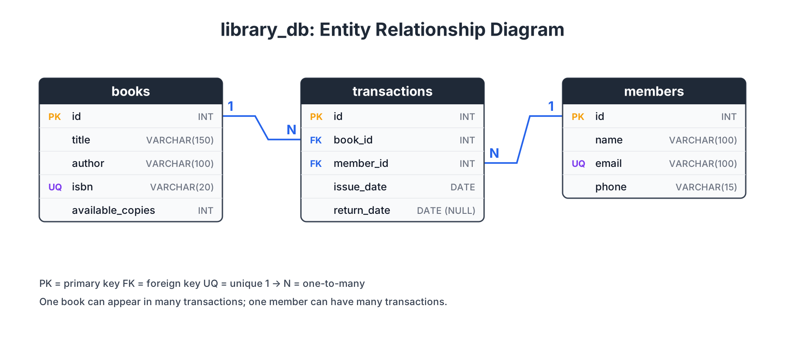
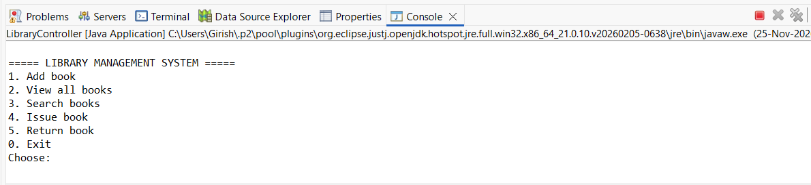
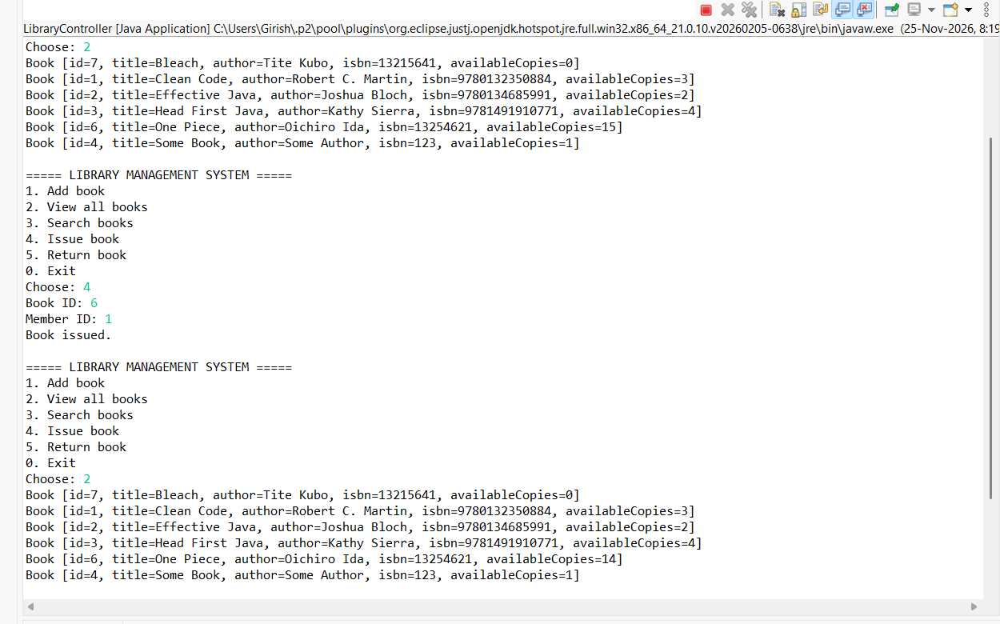
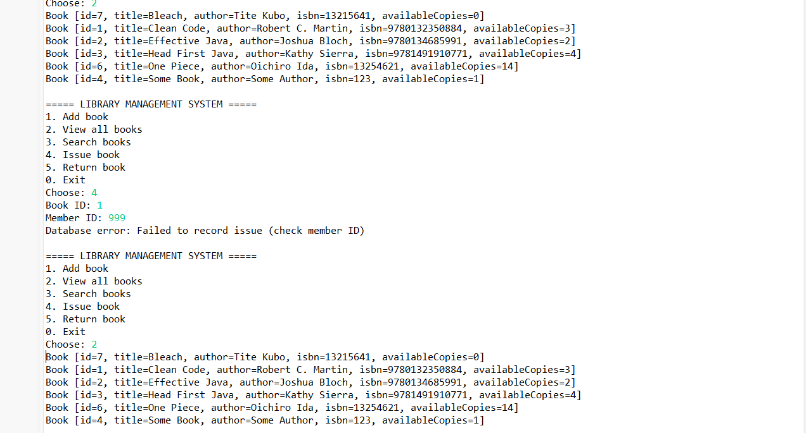

# Library Management System

A console-based Java application for managing books and issuing them to members, built with plain **JDBC**, **Maven**, and **MySQL**. The project focuses on clean layering and correct transaction handling rather than on frameworks.

## Features

- Add new books
- View all books
- Search books by title or author
- Issue a book to a member
- Return a book

## Tech Stack

- Java 17
- Maven
- JDBC (MySQL Connector/J)
- MySQL 8

## Architecture

```
LibraryController (console UI)
        |
LibraryService (business logic and transactions)
        |
Repository layer (BookRepo, TransactionsRepo: all SQL lives here)
        |
MySQL
```

```
src/main/java/com/girish/
├── controller/   LibraryController.java
├── service/      LibraryService.java
├── repository/   BookRepo.java, BookRepoImpl.java, TransactionsRepo.java
├── model/        Book.java
├── util/         DBConnection.java
└── exception/    DataAccessException.java
```

## Database Schema



Three tables:

| Table | Purpose |
|---|---|
| `books` | Title, author, unique ISBN, available copies |
| `members` | Library members (name, unique email, phone) |
| `transactions` | Links a book to a member with issue and return dates |

## Key Concepts Demonstrated

- **Repository (DAO) pattern** with an interface, keeping SQL separate from business logic
- **PreparedStatement** for every query, which prevents SQL injection
- **try-with-resources** so connections, statements, and result sets are always closed
- **Transaction management**: issuing a book reduces stock and records the issue as one atomic unit using `setAutoCommit(false)`, `commit()`, and `rollback()`
- **Atomic stock update**: `UPDATE ... WHERE available_copies > 0` prevents two users from taking the last copy
- **Externalized configuration**: credentials live in `db.properties`, never in code
- **Custom exception** wrapping `SQLException` so upper layers stay clean

## Setup

1. Clone the repository
   ```bash
   git clone https://github.com/igirisssh23/library-management-system.git
   cd library-management-system
   ```
2. In MySQL, run `sql/schema.sql`, then `sql/sample_data.sql`
3. Copy `src/main/resources/db.properties.example` to `src/main/resources/db.properties` and enter your MySQL password
4. Run the app
   ```bash
   mvn compile exec:java
   ```

**Requirements:** JDK 17 or higher, Maven, MySQL 8.

## Screenshots

**Menu**



**Issuing a book**



**Rollback in action:** issuing a book to a non-existent member fails, and the stock stays unchanged.



## Future Improvements

- Add JUnit tests for the repository and service layers
- Replace `DriverManager` with HikariCP connection pooling
- Add logging with SLF4J
- Add member management and a custom business exception
- Migrate to Spring Boot with Spring Data JPA
